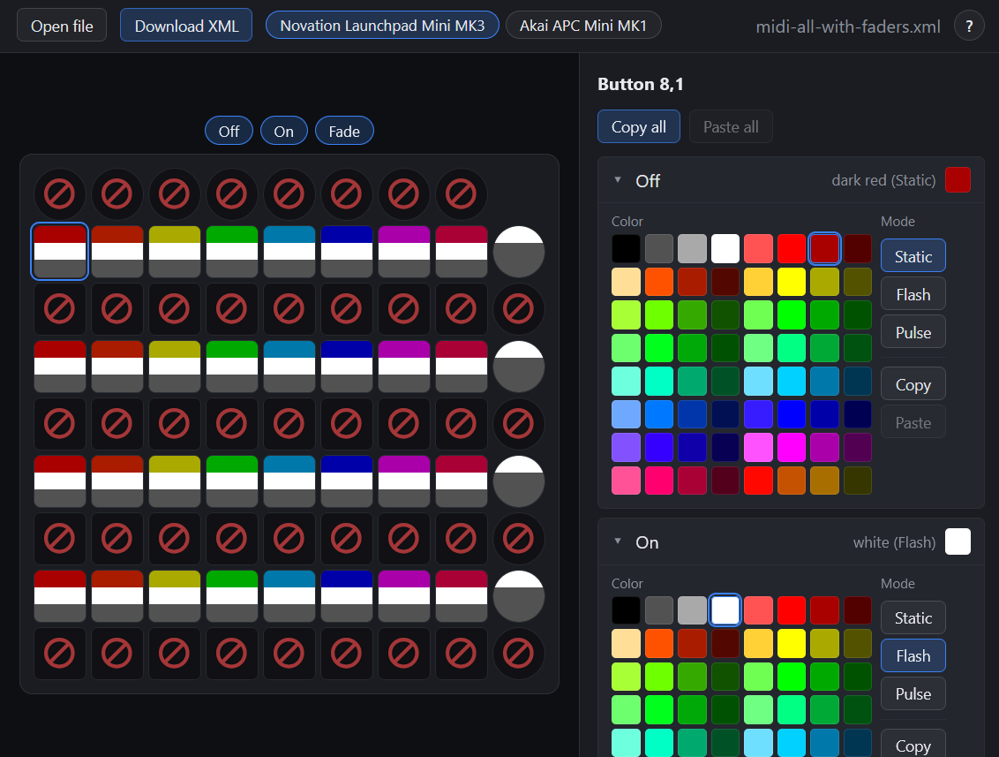

# daslight-midi-pad-editor

A small browser-based editor for **Daslight** XML files that drive a MIDI pad
controller. The mapping (scene ↔ button) is done in Daslight first; this tool
focuses on the **LED appearance** — color and animation mode for the three
control states **Off / On / Fade** of every button on a 9×9 matrix.



## Supported devices

- **Novation Launchpad Mini MK3** — 80 buttons, 64-color palette × 3 modes
  (static / flash / pulse).
- **Akai APC Mini MK1** — 81 buttons, 7 fixed LED states (off, green, red,
  yellow, each with optional blink); per-button color constraints (right
  column = green only, bottom row = red only, shift = no LED).

The active profile is auto-detected from the loaded XML. Adding a new
controller is a self-contained operation under `src/devices/` — no UI code
needs to change.

## Run

```sh
npm install
npm run dev      # @web/dev-server, http://localhost:8000
npm test         # Web Test Runner + @open-wc/testing in headless Chromium
npm run build    # produces dist/daslight-midi-pad-editor.html — a single, self-contained file
```

The dev server uses **import maps** to load Lit directly from a CDN — no
bundler in the dev loop. The build step (esbuild) bundles everything into one
HTML file for distribution.

## Layout

```
.
├── index.html                # entry, import map, <app-root>
├── src/
│   ├── app.js                # <app-root> shell
│   ├── components/           # Lit components (drop-zone, toolbar, launchpad-grid,
│   │                         #   pad-button, settings-panel, color-palette)
│   ├── state/                # reactive store
│   ├── xml/                  # parse / serialize / validate (DOMParser-based)
│   ├── devices/              # device profiles (extension axis)
│   │   ├── profile.js        # DeviceProfile JSDoc typedef
│   │   ├── index.js          # registry + detectProfile()
│   │   ├── launchpad-mini-mk3/
│   │   └── akai-apc-mini/
│   └── lib/                  # shared helpers (selection logic)
├── test/                     # mirror of src/, *.test.js
├── scripts/
│   └── build-single-html.mjs # esbuild → dist/daslight-midi-pad-editor.html
├── docs/                     # source-of-truth references
│   ├── task.txt              # original task brief
│   ├── infos.txt             # OUT-string format notes
│   ├── example-input.xml     # sample Daslight export (LP MK3)
│   ├── every-button.xml      # canonical address list, LP MK3
│   ├── every-button-AkaiApcMini.xml # canonical address list, APC mini
│   ├── launchpad_7bit_colors.txt    # 64-color palette table
│   ├── launchpad_palette_7bit.png
│   └── adr/                  # architecture decision records
├── .gitea/workflows/ci.yml   # CI: test + build + artifact upload
├── CLAUDE.md                 # operational notes for AI assistants
└── README.md
```

## Adding a new device profile

1. Create `src/devices/<your-device>/` with at minimum:
   - `profile.js` — exports a `DeviceProfile` object (see
     `src/devices/profile.js` for the JSDoc typedef).
   - `layout.js` — array of `ButtonAddr` (row, col, kind, allowedStateIds, midi).
   - `out-string.js` — `parse(s, addr)` and
     `encode(stateId, addr, controlState)`.
   - Whatever else the device needs (palette, modes, states list).
2. Register the profile in `src/devices/index.js` (`PROFILES` array).
3. Add tests under `test/devices/<your-device>/`. Verify:
   - Round-trip of every OUT string in a representative XML.
   - `detectProfile()` selects this profile for that XML.
4. Document the LED model in `docs/adr/`.

UI components consume the profile via Lit context and never branch on device
id — keep it that way.

## References

- `docs/task.txt` — original requirements (German).
- `docs/adr/` — architecture decisions and rationale.
